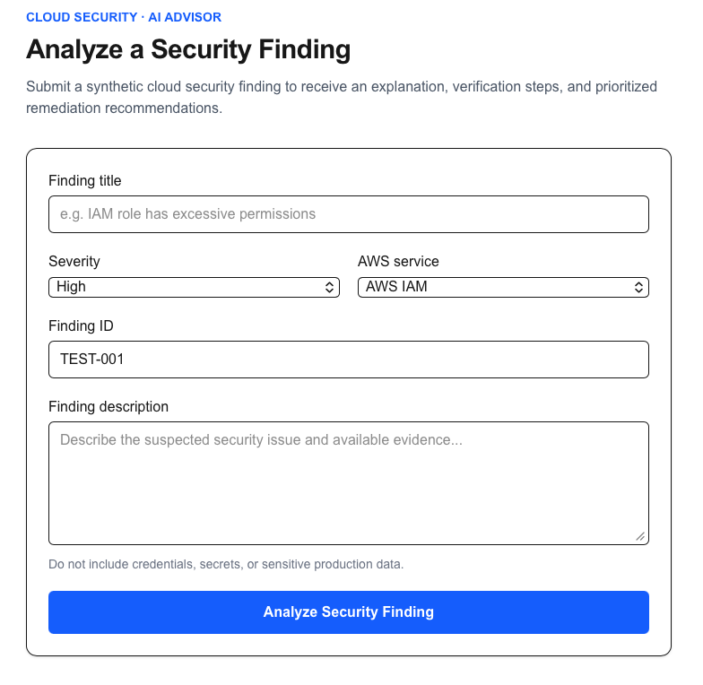
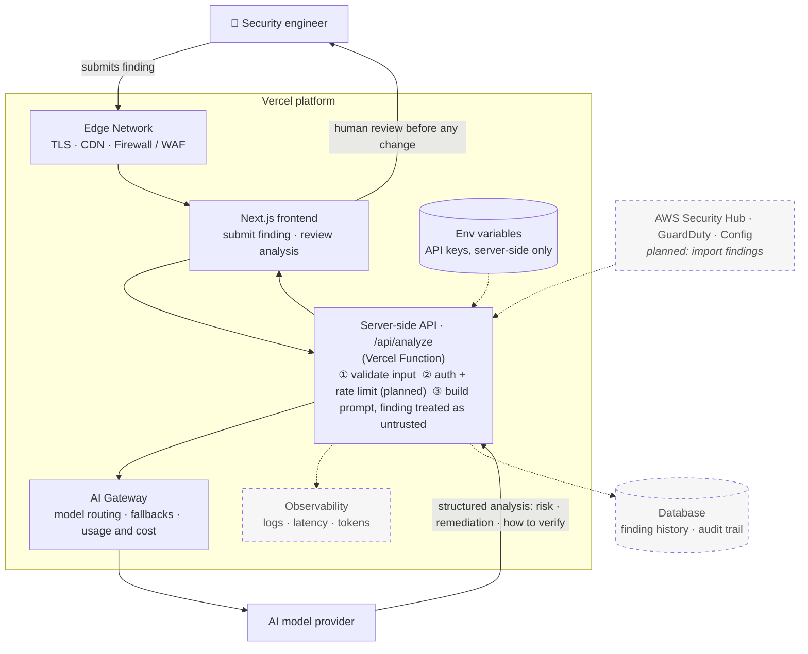

# Cloud Security Advisor

AI-assisted analysis of cloud security findings: paste in a finding, get a plain-language risk explanation, remediation steps, and how to verify the fix.

**Live demo:** [cloud-security-advisor.vercel.app](https://cloud-security-advisor.vercel.app) (protected by Vercel Authentication, [access on request](#live-demo-access)) · **Stack:** Next.js (TypeScript), Vercel AI SDK, Vercel AI Gateway, Zod, Tailwind CSS · **Status:** working proof of concept



## Live demo access

The demo is protected with Vercel Authentication, which limits access to the app and its API endpoints and keeps the AI Gateway from being used by anyone who finds the URL.

To try it:

1. Open the [live demo](https://cloud-security-advisor.vercel.app).
2. Sign in with your Vercel account.
3. If you see an access-restricted page, request access there or [contact me](https://linkedin.com/in/kayode-edoun/) for an invitation. Signing in alone does not grant access; your account must be authorized.
4. Once you're in, submit one of the sample findings and review the analysis.

The demo uses synthetic security findings only. It does not connect to a live AWS environment.

## Why I built it

Tools like AWS Security Hub, GuardDuty, and AWS Config generate hundreds of findings. Teams struggle to decide what matters, and fixing an IAM, network, or encryption finding takes specialist knowledge. In my work as an AWS Solutions Architect, I saw this slow down remediation for many customers.

Cloud Security Advisor turns a raw finding into consistent, decision-ready guidance. A human engineer always makes the final call.

## How it works



Solid lines are live today. Dashed boxes are on the roadmap. The browser never sees API keys or calls the model directly; every request goes through the server-side function.

1. The engineer submits a finding (JSON: id, title, severity, service, description).
2. A server-side Next.js route handler validates the finding against a strict Zod schema (required fields, allowed severities, length limits, no extra fields) and rejects malformed JSON with a safe error.
3. The AI SDK (`generateText`) sends the finding through Vercel AI Gateway to the configured model (currently `openai/gpt-5.2`). Credentials never reach the browser.
4. The response separates verified facts from assumptions, so the engineer knows what still needs checking.

**Example input**

```json
{
  "id": "TEST-002",
  "title": "IAM role has excessive permissions",
  "severity": "High",
  "service": "AWS IAM",
  "description": "A synthetic IAM role may have permissions broader than required."
}
```

Tested end to end with this synthetic finding. The analysis correctly flagged the limits of the evidence provided instead of guessing.

## Why Vercel instead of a custom AWS stack

The same app on AWS would mean wiring together CloudFront, S3, Lambda, API Gateway, IAM, Secrets Manager, CloudWatch, and Route 53. For an early-stage AI app, that is a lot of infrastructure work before the first useful result.

| | Vercel | Custom AWS stack |
| --- | --- | --- |
| Time to first deploy | Minutes | Days of setup |
| Git workflow | Preview URL per pull request, built in | Pipeline to design |
| Model access | AI Gateway: one API, many providers | Custom integration per provider |
| Low-level control | More abstracted | Fully configurable |

**Decision:** Vercel let me spend my time on analysis quality and security design rather than plumbing. I'd revisit AWS-native hosting if the app needed private networking into customer VPCs or deep integration with AWS services. The likely end state is hybrid: Vercel for the app and AI layer, AWS for the customer's data and findings.

## Security design

Because the app handles infrastructure details, security is part of the design, not an afterthought.

- **Access control:** Vercel Deployment Protection (Vercel Authentication) restricts the app and its API endpoints to authorized users, which also protects AI Gateway usage and cost.
- **Secrets:** API keys live in Vercel environment variables, server-side only, never committed.
- **Input validation:** a strict Zod schema enforces required fields, allowed severity values, and length limits, and rejects unknown fields and malformed JSON.
- **Untrusted input:** the finding is passed to the model as data, and the system prompt tells the model to treat it as untrusted, not as instructions.
- **Safe errors:** failures return generic messages; details stay in server logs.
- **Human in the loop:** the app recommends; it never executes infrastructure changes.
- **Honest output:** responses distinguish verified facts from assumptions.

**Next:** application-level authentication with role-based access (RBAC), rate limiting, audit logging, and prompt-injection test cases.

## Roadmap

- **Now:** deployed on Vercel, server-side analysis endpoint with Zod validation, AI SDK and AI Gateway integration, end-to-end test with a synthetic IAM finding.
- **Next:** structured JSON output, application-level authentication and RBAC, rate limiting, audit logging, automated tests, and latency and cost metrics (p95 latency, tokens and cost per analysis).
- **Later:** pull findings directly from AWS Security Hub, keep finding history in a database, add risk scoring with business context, and suggest infrastructure-as-code fixes for human approval.

## Limitations

This is a decision-support prototype. It does not inspect live AWS resources, judge business impact without context, or remediate anything automatically. Every recommendation should be validated by a qualified engineer.

## About me

Built by Kayode (Kay) Edoun, CISSP, former AWS Solutions Architect. [LinkedIn](https://linkedin.com/in/kayode-edoun/)
